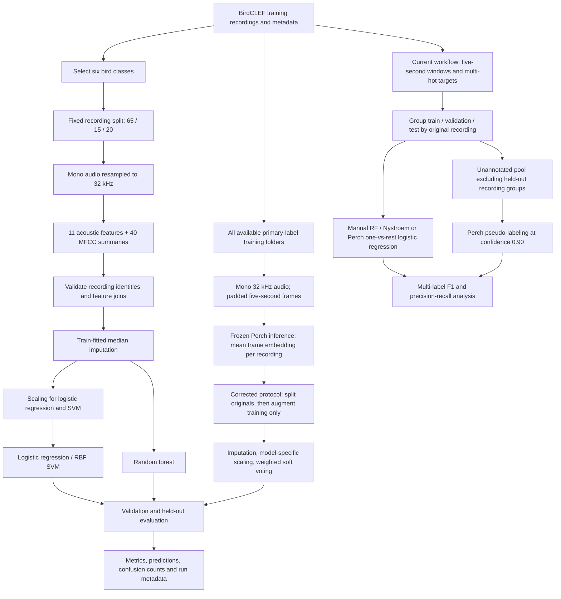
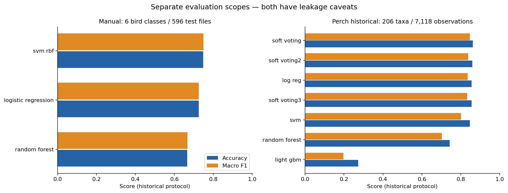
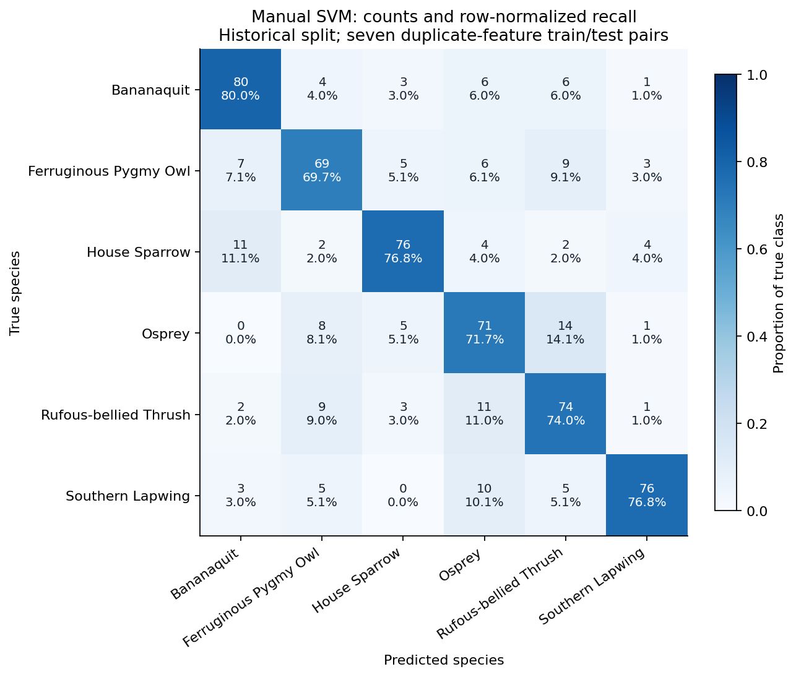

# Bird Species Classifier

Audio classification on **BirdCLEF+ 2026** data, comparing interpretable acoustic
features with frozen **Perch embeddings** and classical machine learning models.
This student research project covers data exploration, signal processing,
supervised learning, evaluation and error analysis.

The best archived manual baseline is an **RBF SVM: 74.83% accuracy and 0.7501 macro
F1 on six bird species**. Archived Perch experiments cover **206 mixed-taxon
classes**. Both evaluation protocols have identified leakage limitations, described
below; these are historical internal results, not competition or deployment scores.

## Problem and scope

The implemented classifiers predict one primary species label per audio recording.
Recordings vary in duration, background noise and acoustic content, and may contain
secondary species. The goal is to study the effect of audio representation and
classifier choice while keeping the downstream models understandable.

Two historical single-label experiment families are preserved:

- **Manual features:** six well-represented bird species, 51 features per recording,
  and a fixed recording-level 65/15/20 train/validation/test manifest.
- **Perch embeddings:** pretrained audio representations extracted across the
  available training folders, followed by logistic regression, random forest,
  SVM and soft voting. Historical results include non-bird taxa.

The current workflow inherited from `main` additionally supports **multi-label
classification of five-second windows**, recording-group splits, hyperparameter
search and Perch pseudo-labeling. Its implementation and figures are retained.
The numeric tables below concern the historical single-label experiments only;
no multi-label score or competition submission score is inferred from plot images.

## Data actually used

Source: [BirdCLEF+ 2026 on Kaggle](https://www.kaggle.com/competitions/birdclef-2026).
Counts below come from the repository's metadata and saved split, not an assumed
competition-wide training protocol.
Source metadata now lives under `ressource/raw_data/`.

| Asset | Verified content and use |
| --- | --- |
| `train.csv` / local `train_audio/` | 35,549 primary-labeled recordings across 206 labels; source for both experiment families |
| `taxonomy.csv` | 234 taxa: 162 birds, 35 amphibians, 28 insects, 8 mammals and 1 reptile; used for bird selection and label names |
| `classes.txt`, `selected_classes.csv` | The six most represented bird classes selected in `analyse_dataset.ipynb` |
| `splits/audio_split_65_15_20.csv` | 2,982 recordings: 1,938 training, 448 validation and 596 test |
| `ressource/features/features.csv`, `mfcc_features.csv` | Committed whole-recording feature tables for that exact six-class manifest |
| `train_soundscapes_labels.csv` | 1,478 annotated rows across 66 soundscape files; used by the current multi-label window workflow, not by the archived single-label scores |
| `sample_submission.csv`, `test_soundscapes/readme.txt` | Target vocabulary/template and hidden-test placeholder; no labeled hidden-test evaluation is available |

| Label | Bird species | Recordings | Train / validation / test |
| --- | --- | ---: | ---: |
| `rubthr1` | Rufous-bellied Thrush (*Turdus rufiventris*) | 499 | 324 / 75 / 100 |
| `banana` | Bananaquit (*Coereba flaveola*) | 498 | 323 / 75 / 100 |
| `fepowl` | Ferruginous Pygmy Owl (*Glaucidium brasilianum*) | 497 | 323 / 75 / 99 |
| `soulap1` | Southern Lapwing (*Vanellus chilensis*) | 497 | 323 / 75 / 99 |
| `houspa` | House Sparrow (*Passer domesticus*) | 496 | 323 / 74 / 99 |
| `osprey` | Osprey (*Pandion haliaetus*) | 495 | 322 / 74 / 99 |

Raw audio, the local dataset archive and generated embeddings are excluded from
version control. Obtain data through the source platform and follow its access
terms and recording licenses (`train.csv` includes license/source fields).
Pretrained weights have their own terms. This repository does not grant rights
to redistribute third-party data or model weights; a source-code license has not
yet been selected.

## Pipeline and technical choices



The diagram separates the reproducible historical baselines from the current
multi-label workflow. **Archived Perch scores were produced before the train-only
augmentation correction.**

### Manual representation

`librosa` loads complete recordings in mono at 32 kHz. The feature vector contains:

- Duration plus mean and population standard deviation of RMS energy,
  zero-crossing rate, spectral centroid, spectral bandwidth and spectral rolloff:
  **11 features**.
- Mean and standard deviation of **20 MFCC coefficients: 40 features**.

These summaries produce a compact, interpretable baseline without training a
neural network. They discard temporal structure. Duration can also encode dataset
collection biases; no duration-ablation experiment is claimed.

| Classifier | Implemented configuration |
| --- | --- |
| Logistic regression | Median imputation, standard scaling, balanced class weights, `max_iter=3000`, seed 42 |
| Random forest | Median imputation, 300 trees, balanced class weights, seed 42, one worker |
| RBF SVM | Median imputation, standard scaling, `C=10`, `gamma="scale"`, balanced class weights |

Imputation and scaling are fitted inside scikit-learn pipelines on training rows
only. Metadata, labels and split names are excluded from the feature matrix.
Balanced class weights retain the existing configuration; their benefit has not
been established by an ablation. Validation scores are reported separately from
test scores; no systematic hyperparameter search is implemented.

### Historical pretrained representation

The extractor loads [Google's bird vocalization classifier, version 8](https://www.kaggle.com/models/google/bird-vocalization-classifier/TensorFlow2/bird-vocalization-classifier/8)
via TensorFlow Hub. Each recording is divided into non-overlapping 160,000-sample
frames (five seconds at 32 kHz), with zero padding at the end. Frame embeddings
are averaged into one recording vector. The pretrained network is frozen.
Torch supplies the dataset/loader; TensorFlow performs model inference.

The executable classifier combines random forest (200 trees), RBF SVM (`C=10`,
probabilities enabled) and logistic regression (`C=1`, `max_iter=1000`) through
soft voting with weights **1:2:3**. Imputation, model-specific standard scaling and
balanced class weights are retained. Estimator/probability seeds are 15.

Saved experiments also include the individual classifiers, a LightGBM trial and
two other voting runs. Individual-model/LightGBM experiments remain in commented
historical code; LightGBM is not an active dependency or runnable CLI option.
Complete configurations of voting variants 2/3 are unavailable. The current code
does not establish a controlled search over these variants.

### Current multi-label window workflow

`scripts/utils.py` aligns soundscape annotations and primary recording labels to
the official target vocabulary. `GroupShuffleSplit` keeps original recordings in
one outer partition (seed 15). Group fractions are approximately 65/15/20; window
counts need not follow those fractions. Unannotated windows from validation/test
recordings are excluded from the pseudo-label pool.

- `scripts/manual_embedding/main.py` preserves the random-forest and
  Nystroem/RBF-plus-logistic grid searches with a predefined validation partition.
  A standalone logistic baseline is configured but not enabled in its model loop.
- `scripts/perch_embedding/embedding_perch.py` saves **one embedding per window**,
  aligned row identifiers and primary labels for training audio.
- `scripts/perch_embedding/main.py` preserves one-vs-rest logistic regression,
  the existing three-fold search over `C`, final training on train + validation,
  and pseudo-labeling at confidence 0.90. Its final `C=0.001` remains explicitly
  fixed in the original workflow rather than selected from the search object.
- Precision-recall, per-class F1 and UMAP plotting utilities remain available;
  plotting extras are installed separately. No KNN result is claimed: that trial
  remains commented out.

These workflows were not retrained during integration. Current `main` supplied
figures, but its numeric scores/predictions and heavy input arrays were not
committed. Run the commands in the reproduction guide to obtain new scores.
The Perch inner cross-validation remains window-based, so neighboring windows can
share a fold boundary; group-aware inner CV and separate threshold selection remain
needed before treating its model selection as independent.

## Archived experimental results

All values below are **recomputed from saved integer confusion matrices**.
Precision, recall and F1 use macro averaging, with undefined values set to zero.
The generator verifies archived accuracy/F1 and manual prediction consistency.
Exact values, weighted metrics, class supports and source SHA-256 hashes are
available in [results/](results/README.md).

### Manual features — six bird classes, 596 test files

| Method | Accuracy | Precision (macro) | Recall (macro) | F1 (macro) |
| --- | ---: | ---: | ---: | ---: |
| Logistic regression | 0.7248 | 0.7267 | 0.7247 | 0.7253 |
| Random forest | 0.6661 | 0.6701 | 0.6659 | 0.6671 |
| RBF SVM | **0.7483** | **0.7547** | **0.7482** | **0.7501** |

**Split limitation:** seven train/test pairs have exactly identical 51-dimensional
feature vectors despite different file paths. The loader warns about them and
[duplicate_features.csv](results/duplicate_features.csv) lists them. These scores
must not be presented as an independent duplicate-free benchmark.

### Perch — historical 206-class mixed-taxon evaluation, 7,118 observations

| Archived run | Accuracy | Precision (macro) | Recall (macro) | F1 (macro) |
| --- | ---: | ---: | ---: | ---: |
| Logistic regression | 0.8554 | 0.8547 | 0.8275 | 0.8347 |
| Random forest | 0.7435 | 0.7684 | 0.6837 | 0.7025 |
| RBF SVM | 0.8462 | 0.8455 | 0.7733 | 0.8009 |
| Soft voting | 0.8618 | 0.8648 | 0.8421 | 0.8462 |
| Soft voting 2 | 0.8597 | 0.8524 | 0.8360 | 0.8383 |
| Soft voting 3 | 0.8554 | 0.8498 | 0.8285 | 0.8332 |
| LightGBM trial | 0.2727 | 0.1640 | 0.2881 | 0.1969 |

**Protocol limitation:** rare-class vectors were augmented with Gaussian noise
before splitting, allowing synthetic siblings of the same recording across
partitions. Noise magnitude used the full array, and augmentation was unseeded.
The saved matrices cannot identify synthetic test rows, and different runs are
not guaranteed to share identical splits. These figures describe archived runs;
they do not prove an independent Perch accuracy or a causal gain over manual
features. The current loader splits originals first, excludes labels with fewer
than five originals from this closed-set evaluation, and augments training only.
**Corrected Perch experiments have not been run.**



### What the errors show

For the manual SVM, Osprey has the lowest class F1 (0.6860); Southern Lapwing has
the highest (0.8216). Osprey → Rufous-bellied Thrush accounts for 14 errors, and
the reverse direction for 11. House Sparrow → Bananaquit also accounts for
11 errors. These observations identify examples to inspect; acoustic or biological
causes require listening and spectrogram analysis.



Historical Perch soft voting's largest directed confusion is Grey-fronted Dove
(`grfdov1`) → White-tipped Dove (`whtdov`), with six errors. Class-level metrics
and further pairs are exported for inspection, subject to the historical leakage
limitation. See [the generated summary](results/summary.md).

## Install and run with uv

Use **Python 3.11** (`.python-version`) and [uv](https://docs.astral.sh/uv/getting-started/installation/).
Run commands from the repository root. The core workflow needs neither Perch
weights nor raw audio when using the committed feature/result tables.

```bash
git clone https://github.com/Kapiloten/bird-species-classifier.git
cd bird-species-classifier
uv sync --locked --group dev
uv run --locked python scripts/summarize_results.py
uv run --locked pytest
uv run --locked ruff check scripts tests main.py
```

Re-fit the three manual baselines from committed features:

```bash
uv run --locked python scripts/manual_embedding/train_logistic_regression.py
uv run --locked python scripts/manual_embedding/train_random_forest.py
uv run --locked python scripts/manual_embedding/train_svm_rbf.py
```

These historical baseline runs default to ignored `results/runs/manual/<model>/`, preserving archived
results. `--features-dir` selects another feature directory; `--output-dir` selects
a run directory. Exports include predictions, accuracy/precision/recall/F1,
confusion counts, classification reports and configuration/input hashes.
Repeated runs in the same output directory replace that run's files.

Optional notebook environment:

```bash
uv sync --locked --extra notebooks
uv run --locked --extra notebooks jupyter lab
```

To extract features from audio, first obtain the dataset and place the original
class folders under `train_audio/<label>/*.ogg`. The complete extraction and Perch
commands are in [docs/REPRODUCIBILITY.md](docs/REPRODUCIBILITY.md), including optional
`uv sync --locked --extra perch`. Perch extraction downloads external weights and
requires substantially more resources. Its dependency resolution is locked, but
end-to-end inference has not been validated during this audit. Native Windows GPU
support depends on TensorFlow's platform constraints; see the
[official installation guide](https://www.tensorflow.org/install/pip).

## Repository layout

```text
README.md
pyproject.toml / uv.lock          # Core, optional and development dependencies
analyse_dataset.ipynb            # Bird taxonomy exploration and six-class selection
features_calssique.ipynb         # Historical manual feature exploration
scripts/
  project_paths.py               # Paths resolved from the repository root
  utils.py                       # Current multi-label loaders and plotting
  multilabel_data.py             # Target alignment and recording-group separation
  single_label.py                # Historical loaders and result exports
  manual_embedding/              # Split, whole-recording/window extraction, training
  perch_embedding/               # Current window workflow + distinct historical CLIs
  evaluation.py                  # Exact metrics and duplicate diagnostics
  summarize_results.py           # Rebuild small portfolio artifacts
splits/                         # Versioned manual recording manifest
ressource/
  features/                     # Committed compact six-class feature tables
  results/ml_classic/            # Preserved historical experiment artifacts
  raw_data/                     # Source metadata; local audio is ignored
  processed_data*/              # Ignored recording/window embeddings
results/                        # Derived tables, figures and provenance
docs/                           # Audit, reproduction guide, validation and GitHub proposals
tests/                          # Synthetic dataset-free regression tests
.github/workflows/ci.yml         # Locked install, Ruff, pytest, archived-result validation
```

The pre-existing local `rapport/` is retained. Its historical interpretation should
be read alongside [the audit](docs/AUDIT.md). Existing paths and notebook names are
kept to preserve references and Git history.

## Limitations and next experiments

- **Data independence:** create a versioned split grouping original recordings
  and duplicates, then consider recordist/site grouping. There are 193 authors
  shared by manual train/test metadata. Feature equality checks do not detect
  every near-duplicate or establish waveform identity.
- **Controlled comparison:** run both representations on the same bird-only
  classes and untouched split; choose hyperparameters/voting weights using
  validation only. Add repeated/grouped evaluations and uncertainty estimates.
- **Current multi-label selection:** use group-aware inner CV for Perch and record
  machine-readable results, selected parameters and thresholds. The pseudo-label
  tradeoff plots use test labels for post-hoc analysis, so they must not become
  threshold-selection evidence for claims on that same test set.
- **Pretraining overlap:** Perch is externally pretrained; overlap with evaluation
  recording sources has not been audited.
- **Temporal and multi-label modeling:** evaluate frame-level predictions and
  aggregation strategies on annotated soundscapes. Current reported models use
  one primary label and whole-recording summaries/mean embeddings.
- **Rare classes and domain shift:** the corrected Perch protocol excludes
  unevaluable rare labels; collect more originals and assess noisy field audio,
  location shift, calibration and unknown species explicitly.
- **Traceability:** historical Perch embeddings, recording order and complete run
  configurations are absent. New extraction saves file identities; new training
  exports seeds/configuration and hashes. No hidden-test score or corrected Perch
  score is available.

This repository demonstrates audio signal processing, transfer learning,
scikit-learn pipelines, experimental analysis and research software practices.
[GitHub description, topics and portfolio wording](docs/GITHUB_PRESENTATION.md)
are provided separately.
